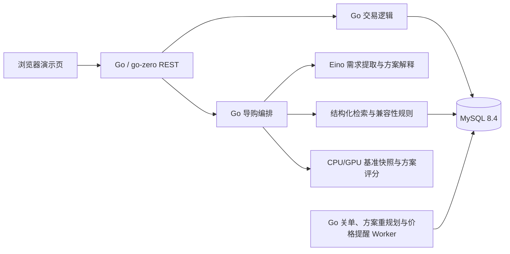

# GoGuide 实际架构

本文件描述当前代码，不把 PRD 中的计划能力视为已交付。项目是独立仓库，未依赖 `go-zero-looklook`。

## 代码边界

| 部分 | 路径 | 职责 |
| --- | --- | --- |
| HTTP 服务 | `cmd/api`、`internal/api/base.go` | go-zero REST 注册路由、鉴权、请求校验与响应 |
| 商品和管理 | `internal/api/catalog.go` | SKU 检索、规格、价格库存维护及审计 |
| 交易 | `internal/api/orders.go`、`internal/trade/trade.go` | 预览、幂等下单、库存预占、支付/关单状态转移 |
| 导购 | `internal/api/guide_*.go`、`internal/domain/domain.go`、`internal/domain/scoring.go` | 意图版本、受控查询、组合规划、兼容性、评分和方案确认 |
| 模拟价格观察 | `internal/api/price_watch.go` | 用户目标价、站内提醒记录、价格版本去重 |
| 后台作业 | `cmd/worker` | 到期订单、方案重规划及模拟降价扫描，失败后下次扫描可重试 |
| 数据库 | `migrations` | 表结构及版本化迁移 |
| 演示与回归 | `internal/api/web`、`scripts`、`eval` | 浏览器页面、HTTP 冒烟测试、固定任务评测 |

当前直接使用 go-zero 的 REST 服务和手写路由，没有使用 `goctl .api` 生成代码。商品、导购和交易在同一个 Go 进程内，Worker 是独立进程，共享 MySQL。首版用模块边界和数据库事务处理一致性，不依赖消息队列或拆分微服务。

## 核心不变量

1. 模型提取自然语言意图，并根据已核验的结构化方案解释选择；SKU、价格、库存和兼容性结论由 Go 与 MySQL 决定。无法验证的硬条件不能进入“已验证方案”。
2. 方案记录意图版本、SKU 价格与库存版本、金额、评分和证据。Worker 发现版本变化后使旧方案失效，并恢复待执行的重规划任务；确认时复核版本与金额，写购物车需要用户明确操作。正式下单重新预览并在事务中锁定库存。
3. 库存按 `available / reserved / sold` 转移。下单预占，付款转已售，取消或到期释放；支付与关闭锁同一订单行，重复请求按状态幂等处理。
4. 电脑配件名称参考公开列表及厂商页面；报价、库存、价格曲线与支付是模拟数据，部分兼容性字段也为演示值。无淘宝官方 API 报价、真实资金或外部订单履约。
5. 价格观察仅检查可售且上架的 SKU，达到用户目标价后按 `(watch_id, price_version)` 写站内事件，重复扫描不会重复提醒。目标价和通知记录属于用户，不提供外部推送。

## 当前容量边界

导购检索每个品类最多 30 个 SKU，规划器取其中最多 12 个，最多 13 个品类；每轮按预算与已选配件兼容性剪枝，保留最多 1200 个组合。当前共有 88 个演示 SKU，其中电脑配件为 26 款、78 个报价。剪枝是面试演示规模的启发式实现，在大目录中仍可能漏召回；需增加规格索引、分层召回及排序评测。Worker 每轮扫描当前未确认方案，规模扩大时需改用事件索引和分页。`demo_price_snapshots` 的 30 天曲线纯属合成场景。工具日志记录在 `guide_tool_runs`，但尚无完整的模型调用成本与生产链路追踪。
