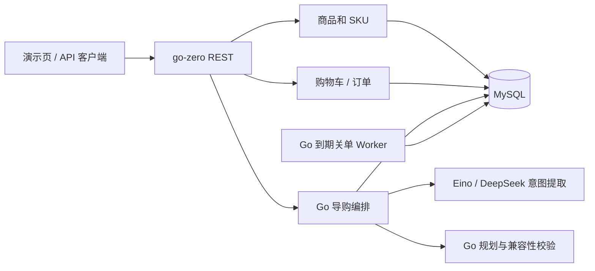
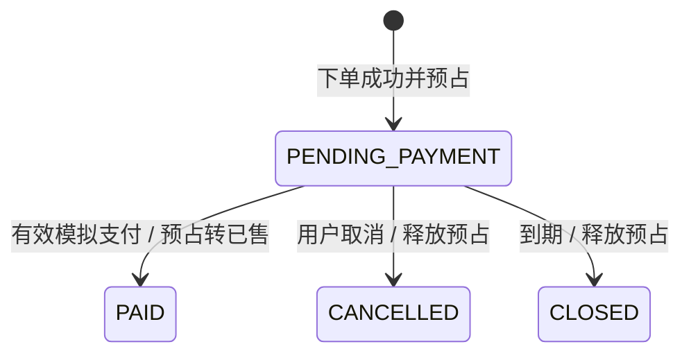

# GoGuide 技术方案与实现分析

| 项目 | 内容 |
| --- | --- |
| 文档定位 | 根据当前仓库代码整理的技术方案；此前的技术选型原稿在本机未找到，本文件不是其原文副本 |
| 对应需求 | [GoGuide PRD](GoGuide_PRD.md) v1.0 |
| 实现范围 | 单平台模拟电商交易 + 笔记本、显示器、扩展坞组合导购 |
| 状态口径 | “已实现”表示代码存在；测试结果和未完成项分别见 [实施状态](../STATUS.md) |

## 1. 目标与技术决策

项目的技术重点是两条可解释的链路：Go 后端保证商品报价、库存和订单状态一致；LLM 理解用户的自然语言购物需求，但不决定交易事实，也不能直接执行写操作。选用模块化单体而非微服务，是因为首版只有十个演示 SKU 和单平台交易，没有跨服务一致性的实际需求。

| 领域 | 当前选择 | 选择依据与边界 |
| --- | --- | --- |
| API | Go 1.26 + go-zero REST | 统一提供商品、交易、导购接口；路由手写注册，未使用 `goctl .api` 生成代码 |
| 持久化 | MySQL 8.4 / InnoDB + `database/sql` | 行锁、唯一键与事务处理库存预占、支付和关单竞争；不依赖模型判断一致性 |
| Agent | Eino + DeepSeek V4.1 Flash 的 OpenAI 兼容接口 | 模型只提取结构化意图；密钥由运行时环境变量提供，未配置时导购不可用 |
| 后台任务 | 独立 Go Worker | 周期扫描到期订单，重启后从数据库继续扫描；首版无需消息队列 |
| 浏览器界面 | 服务内嵌演示页 | 覆盖核心交易和导购操作，复杂交互仍以 API 为准 |
| 部署 | Dockerfile、Compose、SQL 迁移 | 定义 MySQL、迁移、种子、API、Worker；当前环境未实际运行 Docker 构建 |

未引入 Redis、Elasticsearch 或消息队列。当前目录规模和负载下，MySQL 检索与轮询足以验证业务正确性；扩容时先测量瓶颈，再决定是否增加候选召回索引、缓存或异步事件通道。

## 2. 进程与模块

| 路径 | 作用 |
| --- | --- |
| `cmd/api`、`internal/api/base.go` | 服务启动、路由、鉴权入口、请求处理 |
| `internal/api/catalog.go` | 商品检索、SKU 详情和管理员维护 |
| `internal/api/orders.go`、`internal/trade/trade.go` | 订单预览、事务下单、支付回调、关单与库存状态迁移 |
| `internal/api/guide_intent.go` | 会话意图和模型提取适配 |
| `internal/api/guide_plan.go`、`internal/domain/domain.go` | 商品候选、组合规划、硬约束和三态兼容性检查 |
| `internal/api/guide_confirm.go` | 方案版本、金额、价格、库存复核与幂等加购 |
| `cmd/worker` | 每 5 秒扫描到期订单，每轮最多处理 50 条 |
| `migrations`、`cmd/migrate`、`cmd/seed` | 数据库版本迁移和模拟商品初始化 |

## 3. 数据与交易一致性

商品 `products` 表表示通用型号，`skus` 表表示可独立定价和管理库存的具体规格。金额以人民币分的整数存储。SKU 记录 `price_version`、`available`、`reserved`、`sold`；`stock_movements` 保留变动流水，`orders` 以 `(user_id,request_id)` 唯一键防止重复下单。完整字段与索引以 `migrations/001_init.sql` 为准。

下单先生成五分钟有效的预览快照。提交订单时，在 MySQL 事务中复核预览、地址归属、SKU 上架状态、价格版本及库存；按 SKU 行锁执行整单预占。一件商品不足时事务回滚，不留下其他商品的部分预占。订单支付期限当前在 SQL 中固定为 15 分钟，尚未实现 PRD 所述的可配置期限。

模拟支付通知使用独立密钥生成和校验 HMAC-SHA256 签名，服务端校验订单和金额。支付、取消、超时关闭锁定同一订单行，只有待支付订单能迁移；重复事件不会重复扣减或释放。到期后收到成功通知时保持关闭状态并记录异常。Worker 只从数据库查到期订单，因而进程重启后仍可补扫。支付和库存状态依赖数据库时间 `NOW(6)`，避免 API 与数据库时区不一致造成误判。

## 4. 导购 Agent 的权限边界

一次导购消息按如下流程执行：

1. 读取用户自己的会话和 `intent_version`；模型从文本提取预算、品类、用途、硬约束和软偏好。并发更新使用版本检查。
2. 缺少关键预算或品类时追问；无法用结构化数据核验的显式硬条件不生成“已验证”方案。
3. Go 查询有效、有货的 SKU，按预算、品牌、内存等条件筛选，并组合候选。模型不提供价格或库存真相。
4. Go 核算总价，检查视频协议、分辨率、刷新率、笔记本 USB-C 充电能力和扩展坞供电功率。兼容性结果为 `SUPPORTED`、`UNSUPPORTED` 或 `UNKNOWN`；后两者不能作为已验证方案输出。
5. 最多保存三套方案，每套关联意图版本、SKU 与价格版本、金额和证据。用户明确确认后，事务复核方案版本、商品状态、价格、库存和兼容性，再幂等加购。
6. 加购不预占库存。正式购买仍需单独预览和提交订单，导购文本不能越过交易接口。

模型调用默认使用 `DEEPSEEK_API_KEY`、`deepseek-flash` 和 `https://api.deepseek.com`；可以通过 `OPENAI_MODEL`、`OPENAI_BASE_URL` 覆盖。未配置模型时导购返回 503，不生成方案。商品文案和用户消息均按数据处理，不授予写工具权限。

当前导购检索每品类最多 30 个商品，仅取前 8 个进入组合；最多三个品类，因此组合上限为 512。它足以演示十个 SKU，但可能在大目录漏掉可行商品。后续应增加规格索引、分层召回、约束剪枝和排序评测，而不是把现有 30 项任务通过率当作大规模效果。

## 5. 接口、鉴权与可观测性

- `/v1/auth`、`/v1/me`、`/v1/addresses`：注册登录、JWT 退出撤销、个人信息和地址归属。
- `/v1/products`、`/v1/skus`、`/v1/compare`：商品检索、SKU 详情与对比。
- `/v1/cart`、`/v1/orders`：购物车、订单预览、提交、取消和模拟支付。
- `/v1/guide/sessions`、`/v1/guide/proposals`：会话消息、方案查询、工具记录与确认加购。
- `/v1/admin`：管理员维护商品、SKU、价格和库存；具体路由以 `internal/api/base.go` 为准。

服务端按用户 ID 查询地址、订单、会话和方案，管理接口另做角色校验。`guide_tool_runs` 记录查询和兼容性检查的输入摘要、结果与耗时，价格及库存调整有审计表。当前尚缺完整的跨请求 trace、模型 token/费用统计以及历史数据清理策略。

## 6. 验证范围与剩余工作

`go test ./...` 和 `go vet ./...` 已通过。设置独立的 `GOGUIDE_TEST_DSN` 后，可运行 MySQL 集成测试，覆盖库存并发、整单回滚、涨价、支付与取消竞争及回调校验。`scripts/smoke.ps1` 验证 HTTP 购买和导购确认链路。`eval/tasks.json` 是 30 项固定演示任务；真实 DeepSeek 调用的结果文件保存在 `eval/results-deepseek.json`，此前在独立种子数据库上通过 30/30。这仅是该任务集的回归结果，不构成泛化准确率或性能指标。

PRD 中 A01–A16 是目标验收项，尚未逐项全部完成；尤其需要补充进程重启恢复、会话越权、工具超时和更大规模商品目录的验证。淘宝商品资料导入、真实支付、发货和跨平台比价均未实现。未决的产品与授权问题见 [疑问文档](../QUESTIONS.md)。
